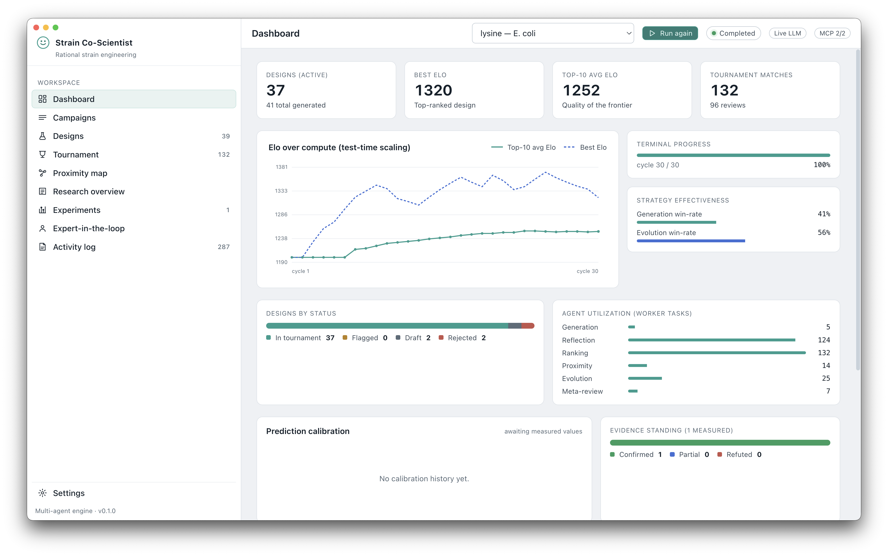

# Strain Co-Scientist

A TypeScript **Electron desktop application** that implements the multi-agent
**Co-Scientist** architecture (Gottweis et al., *Nature* 2026), adapted from
biomedical hypothesis generation to the **rational engineering of industrial
microbial strains**. Give it a product target, a host, and constraints; a team
of specialized agents then generates, peer-reviews, debates, ranks, evolves, and
synthesizes concrete strain-design strategies — with a clean, professional
monitoring & management UI.



---

## What it does

Given a strain-engineering goal (e.g. *"increase mevalonate titer in E. coli"*),
the system runs an asynchronous, self-improving loop that produces a ranked set
of **strain designs**, each with:

- concrete **interventions** (knockouts, overexpression, knockdowns, promoter/RBS
  tuning, heterologous pathways, transporter/cofactor engineering, dynamic
  regulation, enzyme engineering),
- a mechanistic rationale and predicted effect on titer/rate/yield,
- a **Design-Build-Test-Learn (DBTL)** experimental plan,
- construct/primer suggestions,
- risk and biosafety assessment,
- literature citations and an Elo-based quality ranking,
- and a synthesized **research overview** (engineering roadmap) for the scientist.

## Architecture — faithful to the paper, retargeted to strain engineering

Four components from the Co-Scientist paper:

1. **Natural-language I/O** — campaigns + an expert-in-the-loop surface.
2. **Asynchronous task framework** — a Supervisor manages a bounded-concurrency
   worker queue of agent tasks (`src/main/engine/TaskQueue.ts`,
   `src/main/engine/Supervisor.ts`).
3. **Specialized agents** (`src/main/engine/agents/`):
   - **Generation** — literature exploration, simulated scientific debate,
     assumption decomposition, research expansion.
   - **Reflection** — initial / full / deep-verification / observation /
     simulation / tournament reviews, with a biosafety gate.
   - **Ranking** — Elo tournament (init 1200) via pairwise scientific-debate
     matches (`src/main/engine/tournament/Elo.ts`).
   - **Proximity** — similarity graph + clustering for de-dup and match
     selection.
   - **Evolution** — six refinement strategies; always creates *new* designs
     that must re-earn their rank.
   - **Meta-review** — synthesizes recurring critique into per-agent feedback
     (improvement without backprop) and produces the final research overview.
4. **Persistent context memory** — atomic JSON store under Electron `userData`
   (`src/main/memory/Store.ts`); runs survive restarts.

The DBTL experiment loop is drawn from *Robin* (Ghareeb et al., *Nature* 2026),
and the scientist-in-the-loop "collaborator" framing from the biomedical AI
agents review (2024).

### Closing the loop — experimental-results feedback (DBTL "Learn")

The wet-lab path is **closed**, not just flagged. The scientist records an
`ExperimentalResult` (outcome + measured-vs-baseline value + observations)
against any design, and it flows back through the whole engine:

- **Authoritative evidence grade** — a design's results derive an evidence grade
  (`measured-confirmed > measured-partial > predicted-only > measured-refuted`)
  that is the top-level ranking key (`compareDesigns`): a design that *worked in
  the lab* always outranks one that merely argues well, while Elo still orders
  the unmeasured frontier. The Elo math is untouched, so the deterministic
  ladder replay is preserved — measured outcomes enter only as a pure function
  of persisted data.
- **Anchored reasoning** — measured results are injected into tournament match
  prompts as decisive evidence, drive a dedicated **calibration** review mode,
  and seed an **empirical-refinement** evolution strategy + campaign-level priors
  (amplify what worked, avoid what failed).
- **Prediction calibration** — each design commits to a structured
  `QuantPrediction`; a per-cycle `CalibrationProfile` (signed bias, MAE,
  Spearman, Brier, per-intervention-class bias) feeds back into agent prompts so
  the system measurably learns to predict better.
- **Asynchronous re-opening** — results recorded weeks later on a terminated
  campaign re-open it for a results-informed cycle (`reopenCampaign`); a
  campaign won't terminate while there's unprocessed lab data.

See `src/main/engine/learn/Calibration.ts` and the `Experiments` view.

### Tech stack

- Electron + electron-vite, TypeScript end-to-end.
- React 18 + Zustand (renderer); custom CSS design system (no UI framework).
- `@anthropic-ai/sdk` (default LLM) with a tiered model strategy:
  **Opus 4.8** (`claude-opus-4-8`) for Generation/Reflection/Meta-review,
  **Sonnet 4.6** (`claude-sonnet-4-6`) for Ranking/Proximity/Evolution.
  All per-agent models are configurable in Settings. An OpenAI-compatible
  adapter is also included.
- `@modelcontextprotocol/sdk` streamable-HTTP client for grounding.
- `d3-force` for the proximity map; all other charts are hand-rolled SVG.

## Grounding via MCP (optional)

In **Settings → Grounding**, connect either or both servers (with a
*Test connection* button):

- **deep-research** (`/api/mcp`, streamable-http) — literature grounding for the
  Generation, Reflection, and Evolution agents.
- **CodeXomics** (`http://localhost:3002`) — gene existence/sequence checks,
  BLAST/UniProt/AlphaFold/pathway context, and primer/construct design.

When a server is unreachable, the corresponding agent step degrades gracefully
(the design is annotated rather than failing).

## Running

```bash
npm install
npm run dev          # launch the desktop app (electron-vite dev)
npm run build        # production bundles into ./out
npm run dist         # package an installer (electron-builder)
npm run typecheck    # tsc for main, renderer, and tests
npm test             # offline regression tests (no API key required)
npm run check        # typecheck + tests + production build
```

### Reliability and development checks

Campaigns interrupted by an application restart are restored as **paused**;
queued and running tasks are marked cancelled. Resume starts a fresh worker only
after the previous worker has finished. Pause, stop, deletion, and application
shutdown cancel in-flight LLM requests and wait for workers before completing.
MCP HTTP requests have a 30-second deadline; LLM requests have a 120-second
deadline. A failed seed cycle stops with an error instead of spending the rest
of the campaign budget on repeated empty output.

Writes are serialized and use private temporary files plus atomic rename.
Failed snapshot writes remain pending for a later retry; settings take effect
only after they are saved successfully. Input validation and trusted-frame
checks protect the IPC boundary, and the renderer runs in Electron's sandbox.

The regression suite covers persistence failures, lifecycle races, renderer
snapshot/event synchronization, invalid model output, tournament draws and
replay, experimental-result disputes, calibration, and MCP reconfiguration.
GitHub Actions runs `npm run check` on pushes and pull requests. These checks use
mock providers and temporary data directories; they do not validate scientific
claims or replace a live integration test with your configured LLM/MCP servers.

The agents call a live LLM. Open **Settings**, add an Anthropic API key (and,
optionally, the deep-research / CodeXomics MCP servers for grounding) before
running a campaign.

---

## Using Strain Co-Scientist

The default workspace follows a wet-lab decision process: **define the problem →
compare strategies → choose a small experimental batch → record results → refine**.
Engine telemetry remains available under **Research details**.

### 1. Define a research project

Open **Research projects → New project**. The three-step brief asks for:

1. **Goal & strain** — product or phenotype, host, strain background, primary
   improvement and a natural-language production problem.
2. **Experimental reference** — measurement, baseline and success target in a
   shared unit, reference strain, carbon source, culture format, medium,
   conditions, available assays and previous attempts. Unknown values can remain
   blank; the system does not invent a measured baseline.
3. **Lab constraints** — available engineering tools, excluded interventions,
   screening/build constraints and practical preferences. Choose focused,
   balanced or extended research; detailed budgets and comparison weights are
   under advanced settings.

Saving a brief does not start model calls. From **Research workbench**, use
**Edit** beside the experimental reference to add or revise structured context,
including on older projects. Pause running research before editing it. Changes
apply to future research; old design predictions and recorded batch values keep
their original context.

### 2. Configure research and evidence sources

Use **Set up research** or **Settings** to configure a provider and its models.
Optionally enable the literature and CodeXomics connections. Then use **Start
research**. The workbench surfaces a suggested next step, candidate strategies,
experimental reference and lab evidence; it does not use Elo as the headline
measure of biological success.

### 3. Compare and shortlist strategies

**Design strategies** searches titles, genes, intervention details and mechanisms.
Filter candidate strategies, the lab shortlist, all proposals or rejected designs,
and distinguish predicted-only proposals from designs with measured evidence.
Select two or three designs for a side-by-side comparison of proposed changes,
mechanism, predicted effect, reference context, evidence, risks, gaps and first
proposed test. Selection is preserved when background data refreshes.

**Shortlist for lab** selects eligible candidates (reviewed proposals or expert
contributions) for experimental planning.
Draft, reviewing and rejected proposals cannot bypass review by being
shortlisted. A shortlist is a scientist's planning decision, not protocol approval.

Open a design from the workbench, strategies, experiment queue, roadmap or map:

- **Strategy & mechanism** — proposed changes, rationale, predicted effect,
  tradeoffs and missing evidence. AI comparison metrics and lineage are secondary.
- **Evidence & reviews** — active and excluded results, conflicting conclusions,
  supplied references with relevance notes, review narratives and evidence.
- **Plan & record results** — proposed DBTL steps, construct suggestions and
  direct result entry. Model-generated sequences are labelled as suggestions.

A citation is a reference to inspect, not proof of validation. Elo is an AI
comparison score, not a success probability. Evidence labels summarize recorded
conclusions; inspect controls, replicates and culture conditions before drawing
scientific conclusions.

### 4. Plan a batch and record results

**Experiments & results** starts with the lab shortlist and highlights candidates
awaiting an active result. Choose **Record result** on a candidate, or select any
tested design in the recording form, including unsuccessful experiments.

There is no preselected successful outcome. The scientist explicitly records
confirmed, partial, refuted, inconclusive or build-failed. Add the experiment /
batch ID, tested strain ID, measured engineered and control values in a shared
unit, biological replicate count, actual conditions and observations. A paired
control value is entered explicitly rather than copied from the project's
historical baseline. Qualitative observations may omit both numerical values.
Failed saves preserve the form for retry.

Observed percentage changes are signed, without assuming an increase is always
desirable. A zero baseline is retained but has no relative percentage. Conflicting
active conclusions are highlighted. **Exclude from evidence** disputes a result;
restore it when resolved. Excluded records remain visible and in exports.

Evidence ranking and calibration update on save. Resume research, or re-open a
finished project from the experiments view, to incorporate the observations into
new proposals. The calibration charts live under a collapsed advanced section;
explicitly different phenotype measurements are excluded from the comparison.

### 5. Take the plan to the bench

Export a **Markdown experiment brief** for the shortlist, a single design or a
comparison. It includes the research reference, constraints, proposed changes,
mechanism, predictions, DBTL plan, evidence gaps, reviews, result history and
supplied reference notes. Missing information is labelled rather than filled in
with a generated protocol.

Export **CSV result records** from Experiments & results for lab notebooks and
further analysis. Exports preserve batch/strain identity, measurement/control
values, units, replicates, actual conditions, observations and evidence status.

Use **Scientist input** to refine the goal, contribute a design or provide an
expert review. The **Engineering roadmap** synthesizes the research; **Research
monitor**, **AI comparisons**, **Strategy map** and **Activity log** expose the
underlying computational details when needed.

## Repository layout

```
src/
  shared/        domain types, host presets, IPC contract (main <-> renderer)
  main/
    engine/      Supervisor, TaskQueue, agents/, tournament/, prompts/
    llm/         provider-agnostic client (Anthropic + OpenAI-compatible)
    mcp/         deep-research & CodeXomics MCP wrappers
    memory/      persistent context-memory store
    ipc/         typed ipcMain handlers
  preload/       contextBridge typed `window.api`
  renderer/      React UI (views/, components/, store/, styles/)
```

## Notes & scope

"Full functionality" here means the **complete architecture is operational
end-to-end** — all seven roles, the async queue, the Elo tournament, persistent
memory, MCP grounding, and the full monitoring UI — adapted for strain
engineering. Prompts are faithful adaptations of the paper's strategies rather
than a line-for-line reproduction of every supplementary-note prompt. The agents
require an Anthropic key; live literature/genomic grounding additionally requires
the user's deep-research and CodeXomics servers.
